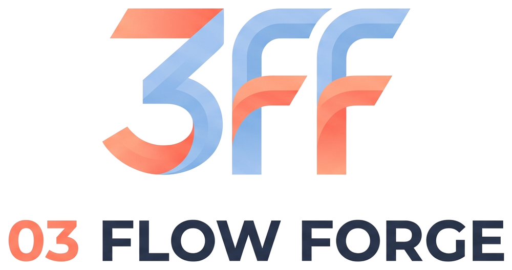

# 03 Flow Forge — AI Automation Portfolio

**Workflows that run while you sleep.**

I'm Hoa Phan, an AI automation engineer based in Vietnam (GMT+7). I build **n8n + AI** workflows (Claude, Gemini, DeepSeek) that save small businesses and e-commerce stores hours of repetitive work every week.

## Projects

| Project | What it does | Stack |
| --- | --- | --- |
| [AI Email Support for Shopify](projects/01-shopify-ai-email.md) | Reads support emails, looks up the order, drafts a reply in your tone | n8n · Gmail · Shopify · Claude |
| [Invoice PDF → Google Sheets](projects/02-invoice-pdf-extractor.md) | Extracts supplier, lines, tax and totals from PDFs and flags mismatches | n8n · Google Drive · Claude · Sheets |
| [Daily Ads + Sales Report](projects/03-ads-daily-report.md) | Morning ROAS/CPA summary with one recommendation, sent to Telegram | n8n · Meta API · Shopify · Claude |
| [RAG Chatbot on Company Docs](projects/04-rag-chatbot.md) | Answers only from your documents, cites sources, admits when it doesn't know | n8n AI Agent · Claude · vector store |
| [AI Lead Qualification](projects/05-lead-qualification.md) | Scores form leads, alerts on hot ones, sends a personalised first email | n8n · Claude · Sheets/HubSpot · Slack |
| [Zapier → n8n Migration: Lead Router](projects/06-zapier-to-n8n-migration.md) | Same lead flow, plus validation and dedupe — ~65–90% lower yearly cost | n8n · Webhook · Telegram/Slack |
| [Appointment Booking Bot + Reminders](projects/07-appointment-booking-bot.md) | Website chat books real free slots 24/7, alerts the clinic, reminds patients 24h before | n8n Chat · Data Tables · Telegram |
| [Workflow Error Alerts](projects/10-error-alerts.md) | Any failed step in any workflow pings the team within seconds and is logged | n8n Error Trigger · Telegram · Data Table |
| [Competitor Price Monitor](projects/11-competitor-price-monitor.md) | Daily check of competitor prices and stock; one message listing only what changed | n8n HTTP · Code · Data Table · Telegram |
| [Instant Quote Form](projects/12-instant-quote-form.md) | Prospects get a priced, branded quote page seconds after submitting a form | n8n Form · Code · Telegram |
| [Multi-Site Monitor](projects/14-website-monitor.md) | Uptime every 5 min plus a daily SSL, domain and hosting expiry report for many client sites | n8n Schedule · Code (TLS, RDAP) · Data Table · Telegram |
| [Live KPI Dashboard](projects/16-kpi-dashboard.md) | One link shows bookings, quotes, uptime and errors, built live from your own tables | n8n Webhook · Data Tables · Chart.js |
| [RAG Chatbot for a 3D Printing Service](projects/18-rag-3d-printing.md) | Answers only from company docs, shows price calculations, cites sources; switch between Gemini, DeepSeek and Claude | n8n AI Agent · Model Selector · Gemini Embeddings · Vector Store |
| [AI Booking Bot (natural language)](projects/19-ai-booking-bot.md) | "Cleaning next Tuesday afternoon?" → real free slots; AI understands, code books, so no double-booking | n8n Information Extractor · Gemini / DeepSeek / Claude · Data Tables |
| [AI Task Reminder Bot](projects/20-ai-task-reminder.md) | Type a task in chat, it lands in Google Sheets; escalating reminders with Done/Snooze buttons and a morning digest | Apps Script · Google Sheets · Telegram · Slack/Discord/email · Gemini / Claude |
| [Daily AI Stock Watch](projects/21-ai-stock-watch.md) | Every weekday: Anthropic (ANT) and AI stock moves, deduplicated 24h news and an AI brief in one Telegram message | n8n Schedule · HTTP · Code · LLM Chain + Gemini · Telegram |

## Try it

[`workflows/invoice-extractor-starter.json`](workflows/invoice-extractor-starter.json) — import into n8n, add a Header Auth credential (`x-api-key` = your Anthropic API key), run. It extracts a sample invoice into JSON and checks that line items add up to the total.

[`workflows/ads-daily-report-v1.json`](workflows/ads-daily-report-v1.json) — runs out of the box with sample data, no API keys needed: computes ROAS/CPA per campaign and writes a daily report with a budget recommendation.

[`workflows/zapier-migration-lead-router-v1.json`](workflows/zapier-migration-lead-router-v1.json) — lead intake webhook with cleaning, validation, dedupe and hot-lead alerts. Add your Telegram (or Slack) credential and run the built-in test.

[`workflows/booking-bot-chat-v1.json`](workflows/booking-bot-chat-v1.json) + [`workflows/booking-reminders-v1.json`](workflows/booking-reminders-v1.json) — a full booking chat with no-double-booking and a 24h reminder job. Setup steps are in the project page.

[`workflows/error-alerts-v1.json`](workflows/error-alerts-v1.json), [`workflows/competitor-price-monitor-v1.json`](workflows/competitor-price-monitor-v1.json), [`workflows/instant-quote-form-v1.json`](workflows/instant-quote-form-v1.json) — error alerting, price monitoring and an instant quote form. Setup notes are on each project page.

[`workflows/site-monitor-uptime-v1.json`](workflows/site-monitor-uptime-v1.json) + [`workflows/site-monitor-daily-v1.json`](workflows/site-monitor-daily-v1.json), [`workflows/kpi-dashboard-v1.json`](workflows/kpi-dashboard-v1.json) — website monitoring and a live KPI dashboard. No AI keys needed.

[`workflows/rag-3dprint-index-v1.json`](workflows/rag-3dprint-index-v1.json) + [`workflows/rag-3dprint-chat-v1.json`](workflows/rag-3dprint-chat-v1.json), [`workflows/booking-bot-ai-v1.json`](workflows/booking-bot-ai-v1.json) — multi-provider AI bots. A free Google Gemini key is enough to start; DeepSeek and Claude are optional.

[`apps-script/task-reminder/`](apps-script/task-reminder/) — no n8n needed: paste into a Google Sheet's Apps Script editor, add a Telegram bot token, and type tasks to your bot. Gemini's free tier covers the AI part.

[`workflows/ai-stock-watch-v1.json`](workflows/ai-stock-watch-v1.json) — daily market brief: no API key needed for prices and news, a free Gemini key for the AI summary, and a Telegram bot.

Sample (fictional) data for every project is in [`sample-data/`](sample-data/).

## How I work

- Clear scope and fixed price before starting
- Error handling, retries and alerts in every workflow
- Handover with a 2-minute video and a one-page guide
- Your credentials stay in your accounts — never in workflow files

## Hire me

Hire me on **[Upwork](https://www.upwork.com/freelancers/~0181d19cd224c54971)** or email **3flowforge@gmail.com**.
