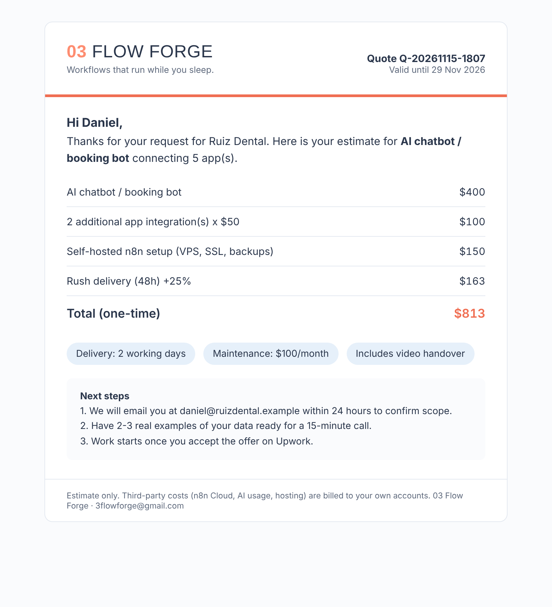

# Instant Quote Form with Branded Quote Page

**Problem:** Service businesses lose leads while they take a day or two to send a price. Prospects want a number now.

**Solution:** A hosted form asks what the client needs. n8n prices it instantly from a rules table (package, number of integrations, add-ons, rush fee), shows a branded quote page right after submit, saves the quote, and pings the owner on Telegram to follow up.

**Stack:** n8n Form Trigger · Code (pricing + HTML) · Respond to Webhook · n8n Data Table · Telegram

**Result:** Working demo. Submitting "AI chatbot / booking bot, 5 apps, self-hosted setup, rush delivery" returned this page in about a second ($400 + $100 + $150 + 25% rush = $813):

**Workflow file:** [`workflows/instant-quote-form-v1.json`](../workflows/instant-quote-form-v1.json)

**Demo:** Video coming soon.

## Adapting it for a client
- Change packages and prices at the top of the `Calculate Quote` code node.
- Swap the colours and wordmark in the HTML for the client's brand.
- Add a Gmail/Outlook step to email the quote as well, and a "Book a call" button linking to their calendar.
