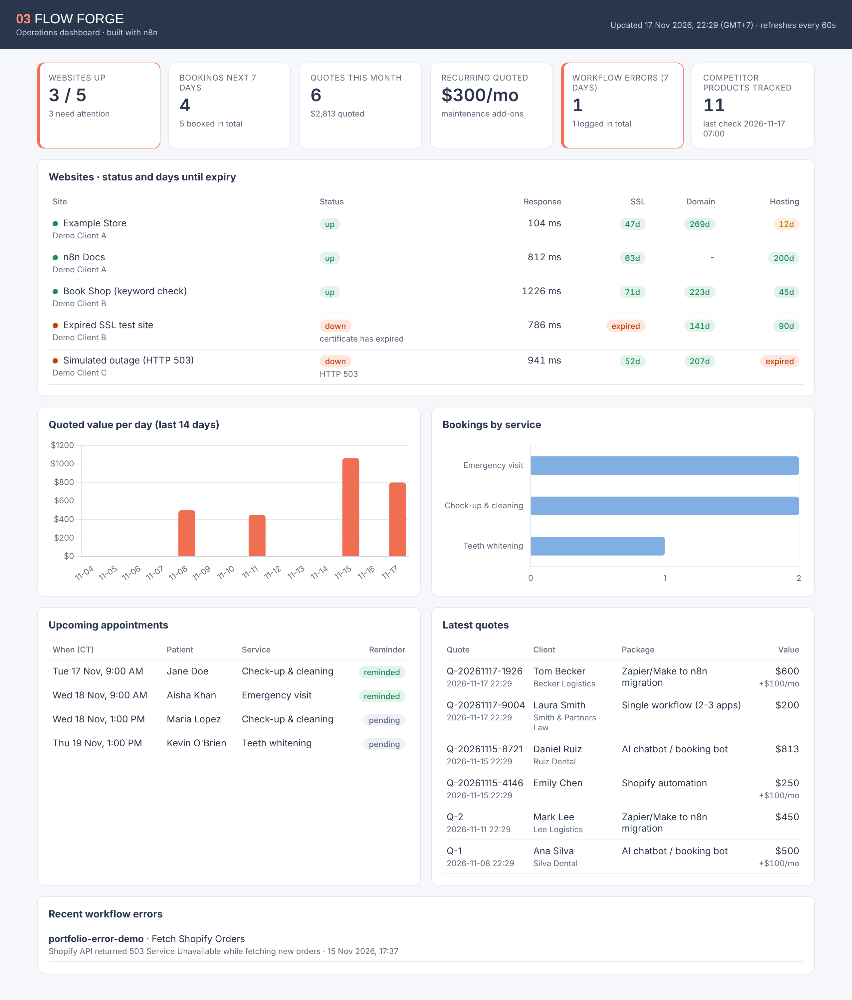

# Live KPI Dashboard for a Small Business

**Problem:** Owners have their numbers scattered across five tools: bookings in one place, quotes in another, uptime and errors somewhere else. Nobody opens five tabs every morning.

**Solution:** One link shows everything on a single page, built live by n8n from the business's own tables every time it is opened. No BI subscription, no extra database.
- Tiles: websites up, bookings in the last 7 days, quotes sent and their total value, recurring revenue, workflow errors, products tracked
- A bookings-per-day chart and a quote-value chart
- Tables of upcoming appointments, latest quotes, sites needing attention and recent errors

**Stack:** n8n Webhook · Data Tables · Code (HTML + Chart.js) · Respond to Webhook

**Result:** Working demo that reads the tables of four other projects in this portfolio (booking bot, quote form, site monitor, error alerts, price monitor). It shows 4/5 sites up, 3 bookings this week, 4 quotes worth $1,863 plus $200/month, 1 workflow error and 11 tracked products:

**Workflow file:** [`workflows/kpi-dashboard-v1.json`](../workflows/kpi-dashboard-v1.json)

**Demo:** Video coming soon.

## Setup
1. Import the workflow and point each `Load …` node at your tables (or remove the ones you don't use).
2. Publish it and open `https://<your-n8n>/webhook/kpi-dashboard`.
3. For a private dashboard, add Basic Auth or Header Auth on the Webhook node.

## Adapting it for a client
- Swap tiles for the client's KPIs (Shopify orders, ad spend, leads, support tickets).
- Add a date-range selector via query string (`?days=30`).
- Email a PDF snapshot every Monday.
